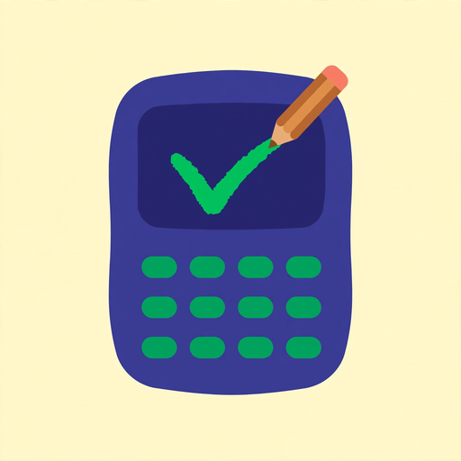

  

<h1 align="center">🧮 Calculadora Alicia</h1>

  <strong>La calculadora educativa que enseña matemáticas paso a paso, como en tu cuaderno.</strong> 
  Gratis · Sin registro · En español · Para primaria

  

  
  
  
  
  

---

## ✨ ¿Qué es Calculadora Alicia?

**Calculadora Alicia** no es una calculadora normal: es una maestra de matemáticas en tu pantalla. En lugar de darte solo el resultado, **muestra cada paso del procedimiento** tal como se enseña en la escuela — las llevadas, los préstamos, los productos parciales, la tabla del divisor — con diagramas dibujados cifra por cifra.

Si buscas una **calculadora de divisiones paso a paso**, una forma de **aprender a dividir con dos cifras**, **sumar fracciones**, calcular el **MCM y MCD** o practicar las **tablas de multiplicar**, aquí cada operación se explica como lo haría tu maestra en la pizarra: despacio, con dibujos y sin saltarse ningún paso.

> 🎯 *"Que el niño entienda el cómo, no solo el cuánto."*

**Ideal para:** niños de primaria (6–12 años), padres que ayudan con la tarea y docentes que buscan recursos gratuitos para el aula.

## 🧰 Herramientas interactivas gratuitas

| Herramienta | Qué resuelve paso a paso |
|---|---|
| [➕➖✖️➗ Calculadora paso a paso](https://calculadoraalicia.app/calculadora/) | Sumas con llevadas, restas pidiendo prestado, multiplicación larga y división de dos cifras |
| [🔢 Calculadora de fracciones](https://calculadoraalicia.app/calculadora-fracciones/) | Suma, resta, multiplicación y división de fracciones con MCM y simplificación con MCD |
| [📏 Regla de tres](https://calculadoraalicia.app/regla-de-tres/) | Regla de tres directa e inversa, con planteamiento y comprobación |
| [📊 Calculadora de porcentajes](https://calculadoraalicia.app/calculadora-porcentajes/) | % de una cantidad, qué porcentaje es una parte, aumentos y descuentos |
| [🔍 MCM y MCD](https://calculadoraalicia.app/mcm-mcd/) | Mínimo común múltiplo y máximo común divisor por descomposición en factores primos |
| [🌳 Factores primos](https://calculadoraalicia.app/factores-primos/) | Descomposición en factores primos con tabla y árbol de factores |
| [√ Raíz cuadrada](https://calculadoraalicia.app/raiz-cuadrada/) | Raíz cuadrada exacta e inexacta con el método clásico |
| [🔄 Conversor de unidades](https://calculadoraalicia.app/conversor-unidades/) | Longitud, masa, capacidad, tiempo y más |
| [✖️ Tablas de multiplicar](https://calculadoraalicia.app/tablas-de-multiplicar/) | Tablas del 1 al 10 para practicar y memorizar |
| [🖨️ Fichas para imprimir](https://calculadoraalicia.app/fichas-para-imprimir/) | Genera 10, 20 o 30 ejercicios con clave de respuestas (modo Mixto y Diagrama) |
| [📐 Operaciones combinadas](https://calculadoraalicia.app/guias/jerarquia-de-operaciones/) | Evaluadora interactiva de jerarquía de operaciones, reducción por reducción |

## 📚 Guías educativas (35)

Explicaciones claras con ejemplos resueltos, errores típicos y preguntas frecuentes:

- [Cómo hacer divisiones de dos cifras](https://calculadoraalicia.app/guias/como-hacer-division-larga/) · [La prueba de la división](https://calculadoraalicia.app/guias/prueba-de-la-division/) · [Partes de la división](https://calculadoraalicia.app/guias/partes-de-la-division/)
- [Cómo restar con llevadas](https://calculadoraalicia.app/guias/como-restar-con-llevadas/) · [La prueba de la resta](https://calculadoraalicia.app/guias/prueba-de-la-resta/) · [Multiplicación de dos cifras](https://calculadoraalicia.app/guias/como-multiplicar-dos-cifras/)
- [Cómo sumar fracciones](https://calculadoraalicia.app/guias/como-sumar-fracciones/) · [MCM y MCD: cómo diferenciarlos](https://calculadoraalicia.app/guias/mcm-y-mcd-como-diferenciarlos/) · [Divisiones de dos cifras](https://calculadoraalicia.app/guias/divisiones-de-dos-cifras/)
- [Resolución de problemas](https://calculadoraalicia.app/guias/resolucion-de-problemas/) · [Jerarquía de operaciones](https://calculadoraalicia.app/guias/jerarquia-de-operaciones/) · [Raíz cuadrada exacta e inexacta](https://calculadoraalicia.app/guias/raiz-cuadrada-exacta-e-inexacta/)
- [La prueba del nueve](https://calculadoraalicia.app/guias/prueba-del-nueve/) · [Llevadas, acarreo y préstamo](https://calculadoraalicia.app/guias/llevadas-acarreo-prestamo/)
- …y 21 más en la [biblioteca de guías](https://calculadoraalicia.app/guias/)

## 👩‍🏫 Para docentes

[Kit para el aula](https://calculadoraalicia.app/para-docentes/): ejemplos resueltos para la pizarra digital, fichas imprimibles con respuestas y guías para explicar cada método en clase. Recurso gratuito para maestros de primaria.

## ❓ Preguntas frecuentes

**¿Calculadora Alicia es gratis?**
Sí, es 100% gratuita y no pide registro.

**¿Muestra el procedimiento o solo el resultado?**
Muestra el procedimiento completo paso a paso: llevadas, préstamos, productos parciales y comprobaciones, como en el cuaderno.

**¿Para qué edades sirve?**
Para niños de primaria (6–12 años), y también para padres y docentes.

**¿Puedo imprimir ejercicios?**
Sí: el [generador de fichas](https://calculadoraalicia.app/fichas-para-imprimir/) crea 10, 20 o 30 ejercicios con su clave de respuestas, listos para imprimir.

**¿En qué idioma está?**
Todo el contenido está en español.

## 🛠️ Tecnología

Sitio ultrarrápido construido con tecnologías modernas:

- **Astro** — sitio estático (páginas de ~40–65 KB, carga en < 1 s)
- **React** — calculadora interactiva con diagramas cifra por cifra
- **TypeScript** — lógica matemática verificada con tests automáticos
- SEO completo: sitemap, JSON-LD (Article, HowTo, FAQPage), canonicals y `llms.txt`

## 📊 El proyecto en números

- 📄 **60 páginas** publicadas
- 📚 **35 guías** educativas
- 🧰 **12 herramientas** interactivas gratuitas
- ⚡ **< 1 s** tiempo de carga
- 🧪 **60+ tests** de lógica matemática pasando

## 🤝 Contacto y comunidad

- 🌐 Sitio: [calculadoraalicia.app](https://calculadoraalicia.app)
- 📧 Email: contact.calculadoraalicia@gmail.com
- ▶️ YouTube · 🎵 TikTok · 📌 Pinterest: **@calculadoraalicia_app**

---

### 🔎 Temas relacionados

`calculadora` · `matemáticas` · `matematicas-primaria` · `division-paso-a-paso` · `aprender-matematicas` · `fracciones` · `tablas-de-multiplicar` · `mcm-mcd` · `regla-de-tres` · `porcentajes` · `raiz-cuadrada` · `fichas-matematicas` · `recursos-docentes` · `educacion-primaria` · `math-education` · `step-by-step-calculator`

---

  Hecho con ❤️ para que ningún niño se quede con la duda del <em>"¿y este número de dónde sale?"</em>

